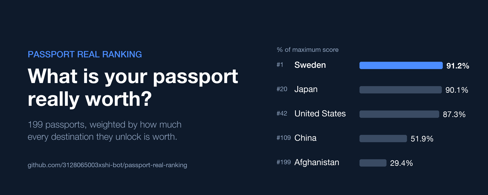

# Passport Real Ranking



A passport ranking that weighs **where** a passport takes you, not just how many places.

Mainstream rankings (Henley Passport Index, Passport Index) count visa-free destinations: visa-free France and visa-free Tuvalu are each worth 1 point. This project scores every destination on its travel value and weights each passport's access by that value.

```
passport_score(p) = Σ over all 199 destinations d  of  entry_weight(p, d) / 100 × tourism_score(d)
```

The home country counts at full weight. `pct_of_max` is the score as a share of a passport that could enter everywhere at weight 100.

## Results (October 2026)

| Rank | Passport | % of max |
|---|---|---|
| 1 | Sweden | 91.2 |
| 2 | Spain | 91.1 |
| 3 | Denmark | 91.1 |
| 17 | South Korea | 90.3 |
| 19 | Singapore | 90.1 |
| 20 | Japan | 90.1 |
| 35 | United Kingdom | 88.9 |
| 42 | United States | 87.3 |
| 109 | China | 51.9 |
| 199 | Afghanistan | 29.4 |

Full table: [`data/processed/passport_ranking.csv`](data/processed/passport_ranking.csv).

## Model

### 1. Entry codes (`data/raw/entry_codes.csv`)

| Code | Entry type | Weight |
|---|---|---|
| S | Free movement (national ID, e.g. within the EU) | 100 |
| A | Visa-free | 98 |
| B | Electronic travel authorisation (UK ETA, Canada eTA, US ESTA) | 93 |
| C | Visa on arrival | 88 |
| D | e-Visa | 78 |
| E | Visa required (embassy / consulate) | 8 |
| F | Entry banned or practically impossible | 0 |

The big drop is between D and E: having to apply at an embassy is the real barrier.

### 2. Destination tourism score (`data/raw/indicator_weights.csv`)

| Indicator | Weight | Direction | Transform | Source |
|---|---|---|---|---|
| GDP per capita | 22.5 | higher | sqrt, capped at $100k | World Bank |
| Inbound overnight tourists | 15 | higher | log | UN Tourism (via Our World in Data) |
| Nature & scenery score | 13 | higher | linear | Hand-scored, informed by UNESCO natural sites |
| Total GDP | 12.5 | higher | log | World Bank |
| Culture & heritage score | 12 | higher | linear | Hand-scored, informed by UNESCO cultural sites |
| Price level (US = 100) | 10 | lower | log | World Bank PPP factor ÷ exchange rate |
| Crime index 0–100 | 5 | lower | linear | From UNODC homicide rate: 100·ln(1+rate)/ln(41), capped |
| Cities 1M+ / 5M+ / 10M+ | 3.33 each | higher | log | UN World Urbanization Prospects 2018 (2020 values) |

Each indicator is capped (if `cap` is set), transformed (`log` = ln(1+x), `sqrt`, or `linear`), min-max scaled to 0–100 across all 199 countries (flipped when `direction = lower`), then multiplied by weight / 100. The sum is the tourism score, out of 100. Missing values score 0 and are listed in the `missing` column.

### 3. Visa matrix

199 passports × 199 destinations = 39,601 pairs. The base is the [Passport Index open dataset](https://github.com/ilyankou/passport-index-dataset) (MIT, last updated 2025-01-12). On top of it:

- `data/raw/free_movement_groups.csv` — S-level free-movement areas (groups with `enabled = 0` are off).
- `data/raw/visa_overrides.csv` — 2025–26 policy changes and judgement calls, applied top to bottom (later rows win), each with a source URL: UK ETA enforcement, China's unilateral visa-free expansion, US Proclamation 10998, Thailand's 60-country list, and more.

## Pipeline

```bash
python3 scripts/build_visa_matrix.py        # -> data/processed/visa_matrix.csv, visa_matrix_wide.csv
python3 scripts/build_country_indicators.py # -> data/processed/country_indicators.csv
python3 scripts/build_tourism_score.py      # -> data/processed/tourism_scores.csv
python3 scripts/build_passport_ranking.py   # -> data/processed/passport_ranking.csv
```

`scripts/make_header.py` redraws `assets/header.png` (3000×1200) and `scripts/make_x_assets.py` the article images in `assets/x/`, both from the ranking; they need Pillow and macOS's Helvetica Neue. `scripts/make_video.py` renders a 1920×1080 countdown video of all 199 passports to `video/` at 60 fps, and `scripts/make_video_vertical.py` a 1080×1920 cut under 3 minutes for Shorts / Reels / TikTok (each passport's note is generated by `scripts/build_video_notes.py` into `data/processed/video_notes.csv`; videos are not committed; both need imageio-ffmpeg). `scripts/make_music.py` synthesises an original lo-fi soundtrack in numpy (no samples or third-party audio) and writes `*-music.mp4` copies, using flags in `assets/flags/` from [flagcdn.com](https://flagcdn.com). `articles/x-article.html` is the article in a form that pastes cleanly into an X Article.

Python 3 standard library only. Don't edit `data/processed/` by hand; change the inputs in `data/raw/` and rebuild.

## Data layout

```
data/raw/countries.csv               199 passport-issuing countries and territories (+6 with limited recognition, include = 0)
data/raw/entry_codes.csv             entry codes and weights
data/raw/indicator_weights.csv       tourism-score weights, directions, transforms, caps
data/raw/manual_scores.csv           hand-scored nature and culture indices
data/raw/manual_estimates.csv        gap fills; rows with override = 1 replace a distorted source value
data/raw/visa_overrides.csv          policy changes since the base snapshot
data/raw/free_movement_groups.csv    free-movement areas (code S)
data/raw/passport_index_2025-01-12.csv
data/raw/sources/                    snapshots: World Bank, UN Tourism, UN WUP 2018 cities, UNESCO 2024
data/processed/                      generated tables
scripts/                             build scripts
```

## Limitations

- Nature and culture scores are subjective.
- The crime index uses homicide rates only; it misses theft and scams, which tourists meet more often.
- Arrival years differ: 2024 for the US, Japan and Spain; 2019 for China, France and Thailand. China's UN figure includes visitors from Hong Kong, Macao and Taiwan.
- Visa data is a January 2025 base plus major 2025–26 changes; smaller bilateral changes may be missing.
- Length of stay is not scored: 14 days visa-free counts the same as 90.

## Sources

- [Passport Index dataset](https://github.com/ilyankou/passport-index-dataset) (MIT)
- [World Bank Open Data API](https://api.worldbank.org/v2/)
- [UN Tourism inbound overnight arrivals, via Our World in Data](https://ourworldindata.org/grapher/international-tourist-trips)
- UN DESA, World Urbanization Prospects 2018, urban agglomerations of 300,000+
- UNESCO World Heritage List, 2024
- Policy changes: see the `source` column of `data/raw/visa_overrides.csv`

## License

Code and original data (scores, weights, overrides) are under the [MIT License](LICENSE).

Third-party data in `data/raw/` keeps its own terms:

- `passport_index_2025-01-12.csv` — Passport Index dataset, MIT License, Copyright (c) 2019 Ilya Ilyankou.
- `sources/worldbank_*.csv` — World Bank Open Data, CC BY 4.0.
- `sources/untourism_*.csv` — UN Tourism, via Our World in Data (CC BY 4.0).
- `sources/un_wup2018_*.csv` — UN DESA, World Urbanization Prospects 2018.
- `sources/unesco_whs_2024.csv` — UNESCO World Heritage Centre.
